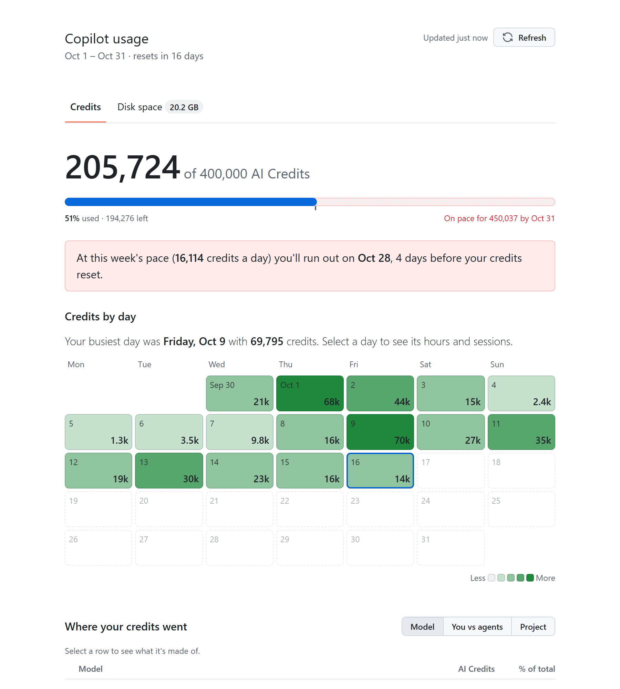
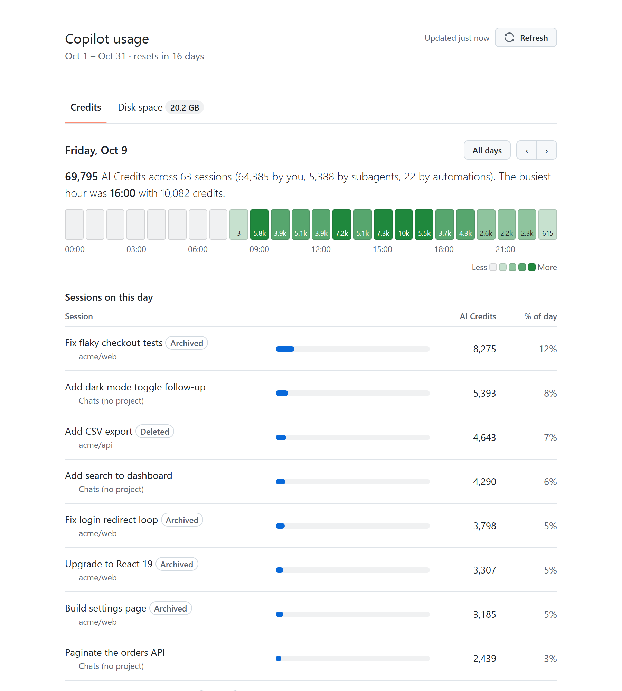
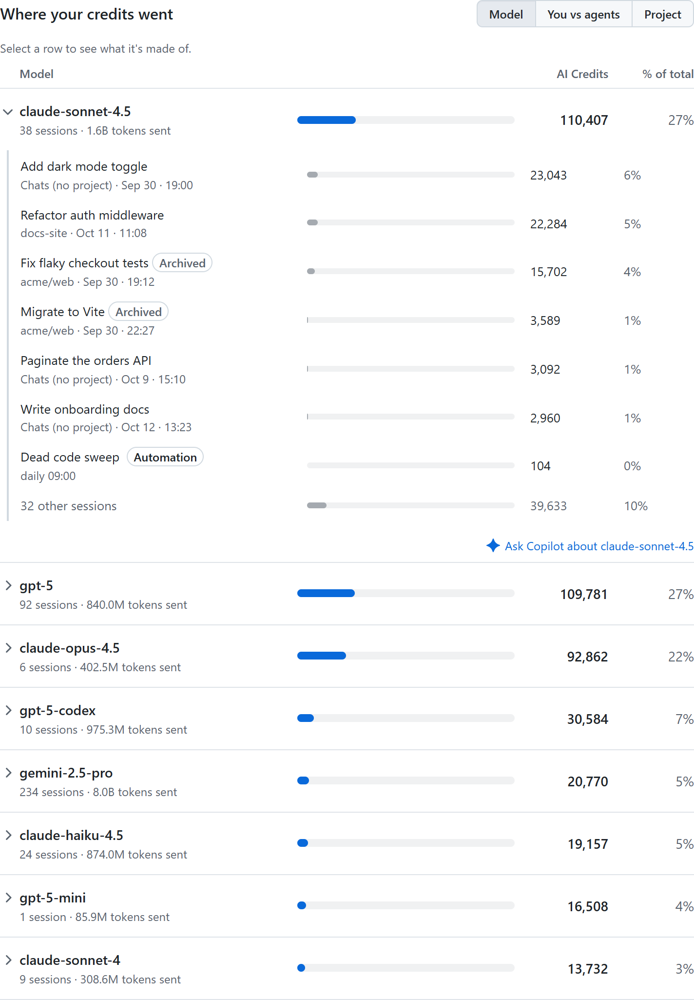
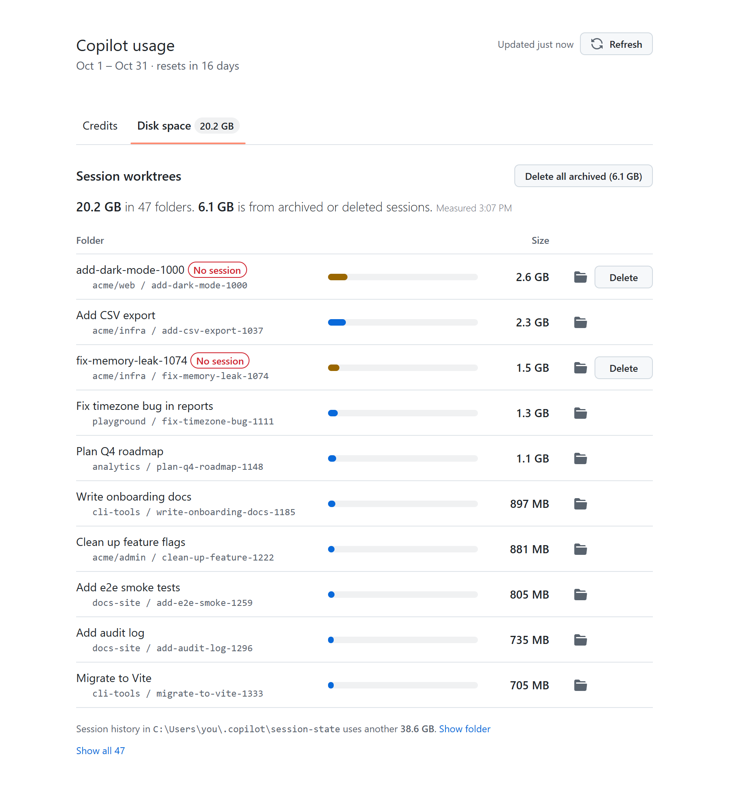

# Copilot usage canvas

A canvas for the GitHub Copilot app that shows AI Credit usage for the current billing period:

- credits used so far, with a progress bar against your plan's limit (if it has one) and a projection for the period
- a calendar of credits per day; select a day to see its hours and sessions
- the split by model, by source (you, subagents, automations) and by project
- the most expensive sessions and prompts, with links that open each session in the app
- a **Disk space** tab: how much space each session worktree takes, with a button to delete the ones whose session is archived or gone
- suggestions for saving credits



| Drill into a day | See where credits went | Free up disk space |
| --- | --- | --- |
|  |  |  |

_Screenshots use made-up data._

## Install

Clone this repo into your Copilot extensions folder:

```powershell
git clone https://github.com/burkeholland/copilot-usage-canvas "$env:USERPROFILE\.copilot\extensions\copilot-usage"
```

Then start a new session, or run `/clear`, and ask Copilot to open the **Copilot usage** canvas. To update later, run `git pull` in that folder.

It requires Node 22.5 or later with `node:sqlite`, which the Copilot app's extension host provides. Opening sessions and folders from the panel works on Windows only for now.

## Where the data comes from

All sources are read-only, except that the Disk space tab can delete worktree folders you choose:

| Source | Used for |
| --- | --- |
| `~/.copilot/session-store.db` | One row per model request: credits, tokens, cache and model |
| `~/.copilot/data.db` | Projects, workspaces, worktrees, automations, and whether a session is archived or deleted |
| `~/.copilot/session-state/<id>/events.jsonl` | Subagent names |
| `gh api /copilot_internal/user` | Billing period, limit and the credits GitHub has billed |
| Worktree folders (from `data.db`) and `~/.copilot/session-state` | Disk space |

Data is built in a worker thread and cached in `.cache.json` next to this file. When the panel opens, it shows the cache right away and rebuilds the data if it is more than 2 minutes old. Use **Refresh** to rebuild on demand.

Disk sizes come from walking every worktree folder, which takes a minute or two. That runs in its own worker, is cached in `.disk-cache.json`, and is re-measured when the cache is more than 30 minutes old. The panel shows progress while it measures.

## Interactions

**In the panel**
- The **Credits** tab opens with your total for the period. If your plan has a limit, a bar shows how much you've used, the striped part shows where this week's pace will take you, and a small tick marks where an even pace would put you today. Add `&limit=<number>` to the panel URL to preview the bar on an unlimited plan.
- Select a day in the calendar to zoom into it: credits per hour (local time) and that day's sessions. The period-wide sections hide while a day is open. Use the arrows to step through days, or **All days** to go back.
- Group by model, source or project, and select a row to see its sessions.
- Select a session's name to open it in the app. Sessions that are archived or deleted are labeled instead of linked.
- The **Disk space** tab lists worktree folders by size. The folder button opens one in File Explorer. Folders whose session is archived, or that no session points at anymore, are labeled and get a **Delete** button (click it twice to confirm). **Delete all archived** removes all of them. Folders of open sessions can't be deleted here; archive the session in the app first.
- Each expanded row, session and suggestion has an **Ask Copilot** button. It sends a prompt to the current session, and the agent can answer it using the actions below.

Deleting is careful on purpose: the server only accepts folders from the last scan that sit directly inside a worktree root (`<root>/<project>/<folder>`), re-checks `data.db` right before each delete and skips any folder whose session was reopened, then runs `git worktree prune` on the source repo so git forgets the worktree. Restoring an archived session later won't bring its files back.

**Agent actions**

| Action | Input | Returns |
| --- | --- | --- |
| `get_summary` | — | Billed vs local total, pace, projection, top models, projects and sessions, cache |
| `get_breakdown` | `by`: `model` \| `source` \| `project` | Every row, with its largest sessions |
| `list_sessions` | `limit?`, `project?`, `model?` | The most expensive sessions |
| `get_session` | `id` (a prefix works) | Credits, models, subagents and the most expensive prompts |
| `get_day` | `date` (`YYYY-MM-DD`, local) | Credits split by you / subagents / automations, per hour, and that day's top sessions |
| `get_disk_usage` | `limit?` | Worktree folders by size, with session status, plus the size of `session-state` |
| `focus` | `by` + `name`, `session`, `day`, or `disk` | Opens and highlights that row, zooms into a day, or switches to the Disk space tab |
| `refresh` | — | Rebuilds the data now and re-measures disk space in the background |

## Files

| File | Purpose |
| --- | --- |
| `extension.mjs` | Canvas registration and actions |
| `server.mjs` | Local HTTP and SSE server, data cache, worker launcher |
| `worker.mjs` | Builds the data off the main thread |
| `data.mjs` | Usage aggregator |
| `disk.mjs` | Measures worktree and session-state folder sizes |
| `web/` | Panel UI, built with Primer CSS |
| `dev.mjs` | Runs the panel without the app, for UI work. Usage: `node dev.mjs` |

## Notes

- The headline is GitHub's billed number. Breakdowns come from local logs and can differ from it slightly, so read them as shares.
- The server listens only on `127.0.0.1`, and every API call needs a per-panel token from the panel URL.
- Opening a session uses the app's `ghapp://sessions/<id>` link, handed to Windows by the server, because the panel's iframe can't navigate the app itself. Only session ids and folders the scan found are accepted.
- The agent actions can't delete anything. Deleting only happens when you click it in the panel.
